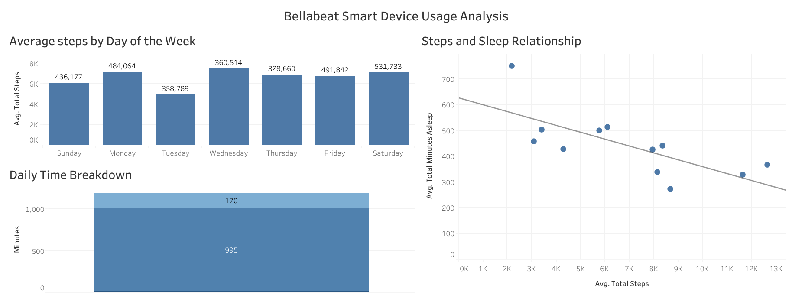

## 🌿BELLABEAT-CASESTUDY 

**Google Data Analytics Professional Certificate: Capstone Project**

**Author:** Beatrice Benson

**Tools:** Google BigQuery, SQL, Microsoft Excel, Power Query and Tableau.

---

## Table of Contents

[Ask](#1-ask-)

[Prepare](#2-prepare-)

[Process](#3-process)

[Analyze](#4-analyze-)

[Share](#5-share-)

[Act](#6-act-)

[Limitations](#7-limitations-)

[Project Summary](#8-project-sumary)

[References](#9-references-)


This Analysis follows the six step analysis; **Ask**, **Prepare**, **Process**, **Analyze**, **Share**, **Act**.


## 1. Ask ❓

### Business Scenario

Bellabeat is a health-focused technology company that develops smart wellness products designed to help individuals monitor and improve aspects of their health and daily activities.

As the company seeks to expand its market presence, its leadership team wants to understand how consumers use smart fitness devices. These insights could help Bellabeat improve its marketing strategies, strengthen customer engagement and identify opportunities for product positioning.

The company has therefore tasked its marketing analytics team with examining existing smart-device usage data to identify behavioural trends and develop actionable business recommendations.


### Problem Statement(Business Task)

Analyze smart-device usage data from Fitbit users to identify patterns in **physical activity**, **daily routines/calories burn** and **sleep behaviour** and provide data-driven marketing recommendations for Bellabeat.


**Key Business Questions**

1. What are some trends in smart device usage?
   
2. How could these trends apply to Bellabeat customers?
 
3. How could these trends help influence Bellabeat marketing strategy?  


**Stakeholders**


**Primary Stakeholders:** Bellabeat Executive team, Product Development team.

**Secondary Stakeholder:** Bellabeat market analytics team, Customer Engagement and digital wellness teams.


## 2. Prepare 📓

### About the Dataset


This project uses publicly available data collected from 30 Fitbit users via an Amazon Mechanical Turk survey between March 12 and May 12, 2016. The dataset was made available by Mobius On Kaggle for educational and non-commercial analysis.

- Source: [FitBit Fitness Tracker Data](https://www.kaggle.com/datasets/arashnic/fitbit) on Kaggle.

- License: [CCO: Public Domain](https://www.kaggle.com/arashnic) through Mobius.

### ROCCC Assessment
To ensure data quality and integrity, the raw Fitbit data was evaluated using the ROCCC checklist:
*   **Reliable:** Moderate. Data was self-reported via survey.
*   **Original:** Yes. It was collected directly from the devices.
*   **Comprehensive:** No. Missing key data like stress data (which Bellabeat tracks).
*   **Current:** No. The data is from 2016.
*   **Cited:** Yes. Publicly available on Kaggle.

Although the dataset did not fully meet all the ROCCC criteria, it was deemed suitable for exploratory analysis after thorough cleaning and validation, with the understanding that supplementary data should be considered for additional analysis.

**How is this data useful?**

While the data does not come from Bellabeat devices, it offers valuable insight into real-world behavior among smart-tech users.


## 3. Process 

**Tools used:** Microsoft Excel (Power Query) and Google BigQuery (SQL).

The data processing was completed in two main stages: initial cleaning in Excel, followed by merging in BigQuery. 

#### Step 1: Data Preparation in Excel (Power Query)

Before uploading to BigQuery, I used Excel's Power Query to perform the following tasks in order to ensure consistency.

1. I combined the `dailyActivity` and `sleepDay` .csv files from both the March-April and April-May folders into two tables.
 
2. I formatted the `ActivityDate` and `SleepDay` columns into valid Date formats (resolving the `########` error in Excel).

3. Removed duplicates user/day records to ensure data integrity

4.  Saved the cleaned tables as .csv files (`daily_activity.csv` and `sleep_day.csv`) and imported them into Google Big Query.


#### Step 2: Checked for duplicates

After uploading the data into Big Query, i ran some few queries to ensure there were no duplicate entries for the same user on the same day before joining the tables.


```sql
SELECT
    Id, 
  ActivityDate, 
  COUNT(*) as duplicate_count
FROM `bellabeat_analysis.daily_activity`
GROUP BY Id, ActivityDate
HAVING duplicate_count > 1;
```
**Results:** 0 rows found, meaning that the data is clean.


#### Step 3: Merged Activity and Sleep Data

I used a LEFT JOIN to combine the two tables into one table based on the User ID and Date. I used the **LEFT JOIN** so that I may not miss any of the daily activity records (like steps and calories) for the days where a user did not record sleep.

To ensure the merge was successful, I ran a validation query to count the total number of rows in the new table.

```sql
SELECT COUNT(*) AS total_rows
FROM `bellabeat_analysis.combined_activity_sleep`;
```
Result: Successfully created a combined table with 457 rows.


## 4. Analyze 📈

I used Google Big Query to run summary statistics on the combined activity and sleep dataset. I calculated the average steps, calories, sleep, and sedentary time across all users to understand general behavior.

```sql
SELECT 
  COUNT(DISTINCT Id) AS unique_users,
  ROUND(AVG(TotalSteps), 0) AS avg_daily_steps,
  MAX(TotalSteps) AS max_daily_steps,
  ROUND(AVG(Calories), 0) AS avg_daily_calories,
  ROUND(AVG(TotalMinutesAsleep), 0) AS avg_sleep_minutes,
  ROUND(AVG(SedentaryMinutes), 0) AS avg_sedentary_minutes
FROM `bellabeat_analysis.combined_activity_sleep`;
```

**Results:**
|Unique_users|avg_daily_steps|max-daily_steps|avg_daily_calories|avg_sleep_minutes|avg_sedentary_minutes|
|------------|---------------|---------------|------------------|-----------------|---------------------|
|    35      |     6547      |    28497      |      2189        |     444         |        995          |

**Insights:**

**1. High Sedentary Time:** Users spend an average of **995 minutes (16.5 hours)** per day sedentary, compared to only a small fraction of time being highly active.


**Below Recommended Activity:** The average daily steps **(6,547)** falls below the widely accepted 10,000-step goal, indicating room for fitness improvement.


**Adequate Sleep:** Users spend an average of 7.4 hours of sleep per night **(444 minutes)**, which is within the recommended 7-9 hour range.


## 5. Share 🔗

**Tools:** Tableau

I built an interactive Tableau dashboard to present these findings to the Bellabeat executive team. The dashboard synthesizes the SQL analysis into three key visualizations.

Link to [Tableau](https://public.tableau.com/views/BellabeatSmartDeviceUsageAnalysis_17942557277620/Dashboard1?:language=en-US&:sid=&:redirect=auth&:display_count=n&:origin=viz_share_link)

Bellow is the dashboard showing average steps by day, the correlation between steps and sleep, and the daily time breakdown.




**Observations**

**1. Average Steps by Day of the Week(top left):** Users are the most active on Saturdays and Wednesdays, but they are the least active on Tuesdays. This pattern suggests that people are using their devices mostly for weekend activities (Saturday) or mid-week exercise (Wednesday), but they are much less active on a typical workday (Tuesday).


**2. High sedentary lifestyle(bottom left):** Users spend an average of 995 minutes (over 16 hours) per day sedentary. This suggests that while users care about their health, their daily routines are overwhelmingly inactive.


**3. Correlation between steps and sleep (top right):** There is a negative relationship between the number of steps taken and the total minutes of sleep. In this dataset, users who walked the most had less slight sleep.


## 6. Act 💡


Based on the findings, below are the recommendations to the Bellabeat Company.


**1. Focus on sleep quality:** Bellabeat should market its app's sleep tracking rather than just promoting step goals.


   
**2. Introduce movement reminders:** With users spending over 16 hours a day sedentary, Bellabeat could launch a feature that reminds users to stand up and move throughout the day, directly addressing this health risk.


**3. Target Mid-Week Engagement:** Since Tuesday shows the lowest activity levels, Bellabeat could launch a mid-week movement challenge or to keep users engaged when their motivation dips.


## 7. Limitations 🛑


 **1. Small Sample Size:** The dataset only contains data from 30 to 35 users. This is too small to be representative of the general population or Bellabeat's entire customer base.
 
 **2. Lack of Demographics:** The dataset does not include age, gender, location, or income. This makes it impossible to understand the categories of each user.
 
 
**3. Outdated Data:** The data was collected in 2016 (March - May). Smart device usage and fitness features might have been updated by now.


**4. Missing Health Metrics:** Bellabeat products focus heavily on stress, menstrual cycles, and mindfulness. This dataset only tracks steps, calories, and sleep, which limits our ability to offer recommendations on Bellabeat's core wellness features.


**Self-Reported Data:** The data was collected via an Amazon Mechanical Turk survey, meaning users opted in to share their data. This can introduce bias, as these users may be more health-conscious than the average person.


## 8. Project Summary


This project analyzed Fitbit smart device data to uncover trends in physical activity and sleep, providing high-level marketing recommendations for Bellabeat. The data revealed that while users are tracking their health, they spend over **16 hours a day sedentary**. Additionally, there is a **negative relationship** between steps and sleep, meaning more steps did not lead to better sleep in this dataset.


## 9. References 📚

[Kaggle dataset](https://www.kaggle.com/datasets/arashnic/fitbit)

Google Data Analytics Professional Certificate: Capstone Project


